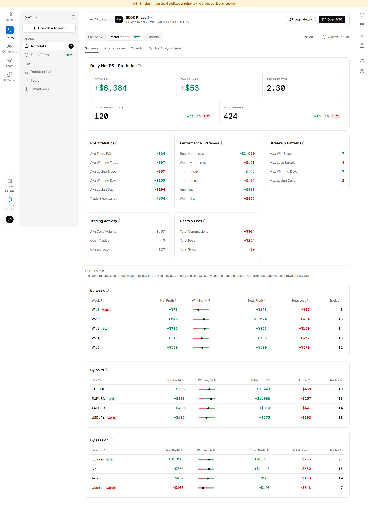
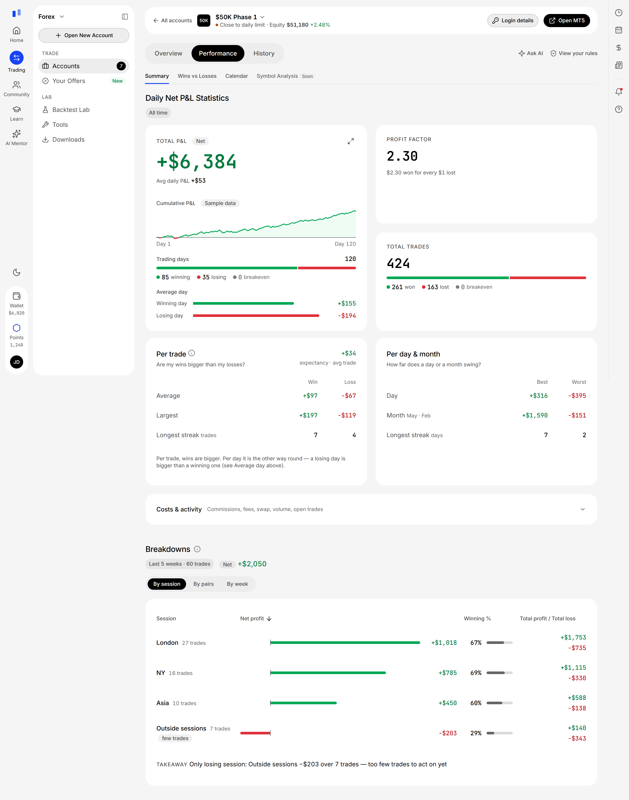

# Goodface · тестове: Performance → Summary

Аудит і редизайн вкладки Performance → Summary на prop-платформі: блоки Daily Net P&L Statistics і Breakdowns. Тут лежать живий прототип у коді, документи процесу і плагін, який збирає файл Figma з прототипу.

Автор — Віталій Савченко, Product Designer.

## Посилання

| Що | Де |
|---|---|
| Файл Figma | [FIGMA_LINK] — дизайн-система; екрани у двох темах, стани блоків, стрілки взаємодій, дошка Logic і стан «у мінусі» — зібрано плагіном з прототипу |
| Живий прототип | [PROTOTYPE_LINK] — AS-IS: `/` · TO-BE: `/tobe/` |
| Презентація (PDF) | у листі |

## Як це виглядає

| До (AS-IS) | Після (TO-BE) |
|---|---|
|  |  |

Ще кадри: [темна тема](screenshots/tobe-dark.png) · [розгорнутий графік](screenshots/tobe-expanded.png) · [Breakdowns з рядком-висновком](screenshots/tobe-breakdowns.png) · [стан «у мінусі»](screenshots/states-loss.png).

## Що де лежить

```
screenshots/          кадри AS-IS і TO-BE
prototype/            живий прототип: AS-IS (вайрфрейм у коді без змін), TO-BE і стан «у мінусі»
docs/
  audit.md            задача 1 — UX-аудит: п'ять проблем за впливом
  product.md          задача 3 — гіпотеза, метрики, як перевірити
  hypotheses.md       гіпотеза до кожного рішення редизайну
  decisions.md        ключові рішення і чому
  submission.md       час по задачах, труднощі, AI у процесі
  research/           00 — зведення ресерчу з позначками довіри і джерелами; 05 — візуальні конвенції.
                      Файли 01–04 (сирі нотатки агентів і скріни конкурентів) не публікуються
serve.js              простий сервер для прототипу (лише Node)
figma-plugin/         плагін Figma, який будує змінні, стилі, компоненти й екран з прототипу
THIRD-PARTY-NOTICES.md  ліцензії іконок Lucide і шрифтів
```

## Як дивитись прототип

- **TO-BE** — `/tobe/`. Що спробувати:
  - сортування в Breakdowns (клік по заголовку колонки), вкладки By session · By pairs · By week і рядок-висновок під таблицею;
  - наведення на криву P&L, кнопка розгортання ⤢ і перемикач періоду 1W · 1M · 3M · All;
  - іконки «i» біля заголовків, розкриття Costs & activity;
  - перемикач теми в лівій рейці, згортання панелі Trading.
- Параметри адреси:
  - `?theme=dark` — темна тема;
  - `?chart=bar` — смужка днів замість кривої (запасний варіант, якщо в продукті немає денного ряду).
- **Стан «у мінусі»** — `/tobe/states.html`: той самий екран на вигаданому рахунку в мінусі, з міткою «Illustrative — not data from the brief».
- **AS-IS** — `/`: вайрфрейм із ТЗ, перенесений у код без змін, для порівняння «до / після».

Числа — з вайрфрейму ТЗ. Крива P&L — на прикладних даних, і на екрані це підписано «Sample data»; з прикладними днями сходяться всі числа екрана, включно з місяцями, тижнями й кількістю виграшних угод тижня. Вигадано лише порядок і розмір окремих днів; порядок підібрано так, щоб на початку крива зайшла нижче нуля, — щоб було видно, як виглядає просідання. Winning % у вайрфреймі — смужки без числа, тож відсотки зчитано з положення точки й звірено з кількістю угод.

### Запустити локально

Потрібен лише Node.js — без пакетів і без інтернету. З кореня репозиторію:

```
node serve.js
```

Далі відкрити `http://localhost:5173/tobe/`; інший порт — `node serve.js 8080`. Підійде й будь-який інший статичний сервер для папки `prototype/`. Порт 5173 потрібен лише скрипту `figma-plugin/extract-screen.js`, який знімає екран для плагіна. Прототип зроблено для десктопа, від 1280 px завширшки. Шрифти вантажаться з інтернету; без мережі сторінка лишається читабельною на системних шрифтах.

Позначки `G-…` у коментарях коду — номери мого робочого журналу рішень. Сам журнал у репозиторій не входить; ключові рішення з поясненням «чому» — у `docs/decisions.md`.

## Плагін Figma

Див. `figma-plugin/README.md`. Коротко: Figma → Plugins → Development → Import plugin from manifest → `figma-plugin/manifest.json`. Команда «Build everything» будує дизайн-систему й екран, «Add submission texts» додає тексти здачі.

## Як працював

≈ 17 годин активної роботи: підготовка 1 · аудит 1 · дизайн і прототип 9 · дизайн-система 2 · перенесення у Figma 3 · продукт, презентація й тексти 1. Деталі й труднощі — у `docs/submission.md`.

Працював у Claude Code: агенти вели ресерч і перевіряли джерела, збирали прототип і варіанти, рецензували роботу й написали плагін Figma. Рішення ухвалював я.
